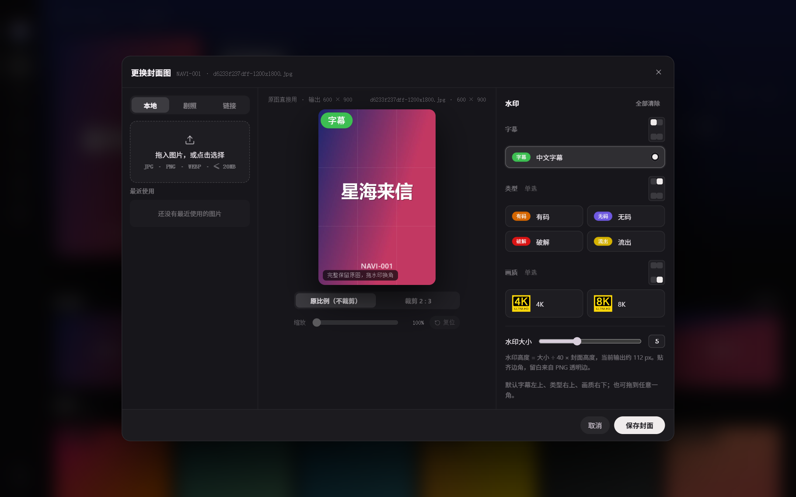
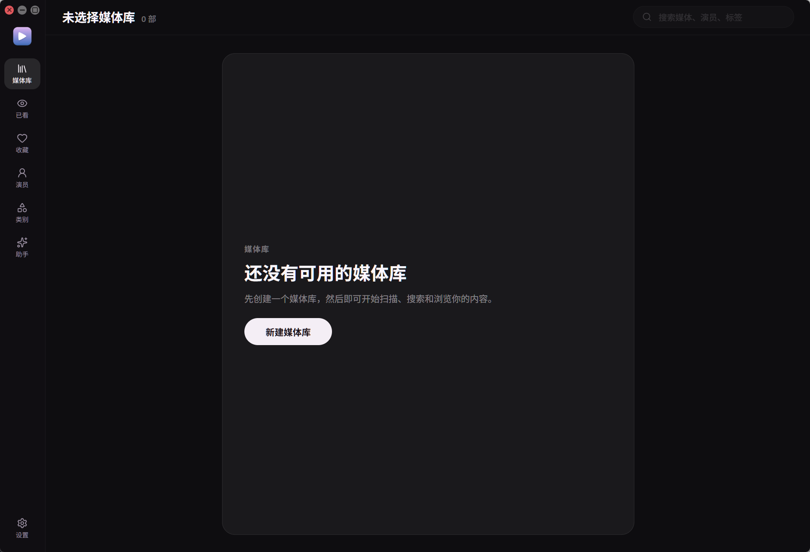

#  Navi

[](https://github.com/StarEllis/Navi-Gui/releases/latest)


**Navi 是一个本地优先的影片库桌面应用**：扫描你硬盘上的影片，读取 `NFO`、海报和字幕，整理成一面好看的海报墙；再配上评分、标签、封面编辑器，以及可以“用大白话找片”的 AI 助手。

它不是套了壳的网页：后端是 Go，界面是 React，数据存在本地 SQLite 里，不需要额外部署任何服务。


> 截图里的影片、演员和海报均为虚构的演示数据。

## 亮点

- **海报墙 + 详情页**：深色界面，卡片上直接显示评分、标签数、已看状态；详情页带剧照、同演员/同类型推荐。
- **扫描快、读得全**：新增 / 删改 / 覆盖三种扫描模式；读取本地 `NFO`、海报、背景图、`extrafanart` 剧照、外挂字幕，并用 `ffprobe` 提取分辨率、编码、时长。
- **自己的评分与标签**：1–5 星评分、分组标签、批量标注，以及按评分 / 标签组合筛选并保存为常用条件。
- **封面编辑器**：换封面、裁成 2:3、贴上字幕 / 有码 / 无码 / 破解 / 流出 / 4K / 8K 等水印，随时恢复原图。
- **AI 助手**：用一句话找片、查统计；也可以让它收藏、打标签、改影片信息——改之前一定先让你确认。支持按剧情“意思”找片。
- **远程访问**：内置 Jellyfin 兼容 sidecar，让 Infuse 等客户端在局域网里直接读取你的片库。
- **全本地存储**：数据都在程序旁边的 `data/` 文件夹里，拷走就是备份。

## 界面预览

### 详情页

剧照、演员、类型、个人标签、评分和推荐集中在一页，右上角可直接打开所在文件夹、编辑 `NFO`。


### 封面编辑器

在详情页的封面上右键，选择“更换封面图”。图片可以来自本地文件、剧照、图片链接或剪贴板；水印位置可拖到任意一角，大小可调。



### 评分与标签筛选

按“我的评分”和“我的标签”组合筛选：同一分组内是“或”，不同分组之间是“且”，常用组合可以存为“常用”一键复用。


## 快速开始

### 1. 下载并运行

1. 打开 [Releases](https://github.com/StarEllis/Navi-Gui/releases/latest)，下载最新的 `Navi.exe`。
2. 放进一个**你有写权限**的文件夹，例如 `D:\Apps\Navi`（不要放在 `C:\Program Files\` 这类受限目录）。
3. 双击运行。首次启动会在 `Navi.exe` 旁边生成 `data/` 文件夹，之后所有数据都在里面。

系统需要 Windows 10 / 11，并带有 WebView2 Runtime（Windows 11 和较新的 Windows 10 已自带）。

### 2. 新建媒体库

第一次打开时还没有媒体库，点击“新建媒体库”，填写名称并选择一个或多个影片文件夹即可。



### 3. 扫描

创建后点顶部的刷新按钮开始扫描。目录很大时，建议先用“新增刷新”。

| 模式 | 作用 |
| --- | --- |
| 新增刷新 | 只补入新文件 |
| 删改刷新 | 同步文件的新增、删除和修改 |
| 覆盖刷新 | 清空当前媒体库后重新入库 |

### 4. 配置播放器（可选）

默认用系统播放器打开影片。想用自己的播放器，到“设置 → 常规”里打开“使用外部播放器”并选择程序。

### 升级

直接用新的 `Navi.exe` 覆盖旧文件即可。首次启动时 Navi 会自动升级本地数据库结构；升级过程中请不要强制结束程序，建议顺手备份一份 `data/` 文件夹。

## 功能详解

### 媒体库与扫描

- 可创建多个媒体库，每个库支持多个文件夹；可自定义卡片的视图模式、标题字段和副标题字段。
- 支持 `.mkv` `.mp4` `.avi` `.mov` `.wmv` `.flv` `.webm` `.m4v` `.ts` `.strm`。
- 优先读取与影片同名的 `NFO`；自动识别 `poster` / `folder` / `cover` / `thumb`（海报）、`fanart` / `backdrop`（背景图）、`extrafanart/`（剧照）和外挂字幕。
- 没有 `NFO` 且时长足够的影片，可用 `ffmpeg` 自动截取海报、背景图和预览图（可在设置里开关，并调整最短时长和预览张数）。
- 可选接入 [Everything](https://www.voidtools.com/) 的 HTTP 服务，加速超大目录的扫描。
- 应用内置 `NFO` 编辑器，改完直接写回文件。

### 浏览、搜索与播放

- 搜索媒体、演员、标签；对视频编号和数字范围做了专门的匹配优化。
- 排序：加入日期、发行日期、视频编码、观看时间、我的评分、打分时间。
- 收藏、已看、继续观看；列表会记住滚动位置和筛选条件。
- 随机播放、外部播放器、一键打开所在文件夹。
- 详情页推荐“继续看”：同演员、同类型、同编号前缀的作品。

### 评分、标签与筛选

- 给影片打 1–5 星，再点一次相同星级即可取消。
- 创建标签并分组，可重命名、合并、删除；可批量给多部影片评分或增删标签。
- 在“我的标签”页面查看每个标签覆盖了多少部作品。
- 组合筛选并保存为“常用”。

### 演员与头像

- 演员页按作品数量浏览，也可搜索。
- 自动补全演员头像候选；也可手动选择本地图片或粘贴图片链接——链接图片会下载并缩放保存到本地，之后不再依赖原链接。
- 内置演员别名映射，改善不同语言 / 别名下的识别。

### 预告片与剧照补全

在详情页的“预览剧照”右侧点“补齐”，Navi 会联网为这部影片补全缺少的预告片和剧照。下载下来的文件会放在影片所在的文件夹里：预告片是 `trailers/trailer.mp4`，剧照在 `extrafanart/` 里，之后不再依赖网络。

### 封面编辑器

- 入口：详情页封面右键 → “更换封面图”。
- 图片来源：本地文件 / 本片剧照 / 图片链接 / 剪贴板，并保留“最近使用”。
- 构图：保持原比例，或按 2:3 裁剪并拖动、缩放调整。
- 水印：
  - 字幕（中文字幕）；
  - 类型（有码 / 无码 / 破解 / 流出）；
  - 画质（4K / 8K）；
  - 每类水印可放在四个角中的任意一个，大小可调；会根据影片的分辨率、字幕和标题自动给出推荐。
- 保存后可随时“恢复原封面”。
- 没有封面、由 `ffmpeg` 自动生成的海报，也会居中裁成 2:3，与编辑器保持一致。

### AI 助手

侧边栏的“助手”页面：用一句话描述条件、剧情或想看的统计，助手去你的片库里查，再把影片以海报卡片摆出来。

**它能做什么**

- 找片和统计：查询只在一条独立的**只读**数据库连接里进行，不会改动片库。
- 按“意思”找片（语义搜索）：不用猜简介里写的是哪个词。助手会把语义搜索和关键词搜索的结果合并，减少漏片。
- 整理片库：收藏、已看、评分、标签（含重命名 / 合并 / 删除）、改 `NFO` 信息、补全预告片与剧照、重新扫描、从库里移除，以及删除影片文件。
- 直接播放影片、打开所在文件夹；在详情页点“问助手”，可带着当前影片提问。

**三档权限**（输入框下方随时切换）

| 权限 | 行为 |
| --- | --- |
| 仅可查看 | 只能查询，不能修改 |
| 可以修改 | 每次修改都会先弹出确认卡片，点了“执行”才生效 |
| 完全权限 | 收藏、评分、标签等小改动直接执行；改影片信息、合并或删除标签、移除、删文件等仍需确认 |

删除影片文件时，文件不会被直接彻底删除，而是先移入同一磁盘上的 `Navi回收站` 文件夹。

**怎么开始用**

1. 打开“助手”页，点输入框下方的接口选择，进入“接口预设”。
2. 新建一个预设：接口类型选 **OpenAI 兼容**（DeepSeek、OpenRouter、中转站等）或 **Anthropic**，填写地址（可留空用官方地址）和 API Key，拉取或手填模型名。
3. 选好预设和模型，就可以开始提问。
4. 想用“按意思找片”：在同一个设置里配置向量模型（默认使用 SiliconFlow 的 `BAAI/bge-m3`，任何兼容 OpenAI 格式的向量接口均可），连接测试通过后构建索引。索引可增量更新、随时停止。

**关于隐私，请注意**

- 助手需要你**自己提供**模型服务和 API Key，Navi 本身不内置任何模型。
- API Key 以明文保存在本机的 `data/assistant.json`，不会上传到别处。
- 使用助手时，你的提问和助手查到的影片信息会发送给你所配置的模型服务；构建语义索引时，会把影片的标题、类型标签和简介发送给向量接口。如果不希望这样，不配置助手即可，其余功能不受影响。

### 远程访问（Jellyfin 兼容）

1. 打开“设置 → 远程 Jellyfin”。
2. 填写监听地址、用户名、密码，打开 `Jellyfin Sidecar`，设置端口（默认 `18096`）和服务器名称。
3. 在 Infuse 或其他 Jellyfin 客户端里添加服务器。

局域网使用时，监听地址可以写 `0.0.0.0`，但客户端里要填这台电脑在局域网里的真实 IP（如 `192.168.x.x`），不能填 `0.0.0.0`。

## 数据都放在哪

所有运行时文件都在 `Navi.exe` 旁边的 `data/` 文件夹里：

| 路径 | 内容 |
| --- | --- |
| `data/navi.db` | 本地数据库（媒体库、评分、标签、观看记录等） |
| `data/settings.json` | 桌面设置 |
| `data/assistant.json`、`data/assistant/` | 助手的接口预设、历史对话和语义索引 |
| `data/cache/` | 封面等图片缓存 |
| `data/backups/` | 数据库备份 |
| `data/ffmpeg/` | 应用内下载的 FFmpeg（如果用了自动下载） |
| `data/logs/` | `navi.log` 等日志（超过 20 MB 会轮换） |
| `data/app.yaml` | 可选，手动指定 FFmpeg 路径 |

需要把数据放在别处时，设置环境变量 `NAVI_DATA_DIR` 指向一个文件夹，Navi 就会把 `data/` 建在那个文件夹里。

> 从旧版本升级时，如果你的数据原本在 `Navi.exe` 旁边的 `navi.db` 等文件里，请先备份，再确认新版本启动后的数据是否完整。

## 依赖

### FFmpeg / FFprobe

Navi 用它们读取视频信息（时长、分辨率、编码、字幕轨）和生成缩略图。查找顺序：

1. 环境变量 `NAVI_FFMPEG_PATH` / `NAVI_FFPROBE_PATH`
2. `data/app.yaml` 里的 `ffmpeg_path` / `ffprobe_path`
3. 应用自己下载到 `data/ffmpeg/` 的那一份
4. `C:\ffmpeg\bin\`
5. 系统 `PATH`

```yaml
# data/app.yaml
ffmpeg_path: C:\ffmpeg\bin\ffmpeg.exe
ffprobe_path: C:\ffmpeg\bin\ffprobe.exe
```

找不到 FFmpeg 时，Navi 仍可正常打开、浏览和播放，只是拿不到时长、分辨率、字幕轨，也生成不了缩略图。此时界面顶部会出现提示，点“下载并启用”即可自动下载精简版（约 68 MB，解压后约 129 MB）到 `data/ffmpeg/`，校验通过后立即生效，无需重启。

下载源默认是 [BtbN/FFmpeg-Builds](https://github.com/BtbN/FFmpeg-Builds/releases)；GitHub 直连失败时会依次尝试几个反向代理。安装包必须与官方 `checksums.sha256` 里的 SHA256 一致才会落地，取不到校验值就会中止安装。也可以用环境变量 `NAVI_FFMPEG_DOWNLOAD_URL` 指向自己的 zip（此时会跳过 SHA256 比对，仅做最后的 `ffprobe -version` 验证）。

### Everything（可选）

1. 安装 Everything 并开启 HTTP Server；
2. 在“设置 → 扫描”里打开“调用 Everything”；
3. 填写地址，例如 `http://127.0.0.1:8077`。

## 从源码构建

需要：Go `1.24+`、Node.js 与 npm、[Wails CLI](https://wails.io/docs/gettingstarted/installation)，以及 WebView2 Runtime。

```bash
go install github.com/wailsapp/wails/v2/cmd/wails@latest

git clone https://github.com/StarEllis/Navi-Gui.git Navi
cd Navi
cd frontend && npm install && cd ..

wails dev      # 开发模式
wails build    # 生产构建，产物在 build/bin/Navi.exe
```

## 项目结构

```text
Navi/
├─ main.go, app.go             # Wails 入口与后端主逻辑，向前端暴露应用能力
├─ app_*.go                    # 按功能拆出的后端：封面编辑器、助手、用户标签、推荐等
├─ remote_access.go            # Jellyfin 兼容 sidecar
├─ assistant/                  # AI 助手：模型接口、工具、只读沙箱、会话、语义索引
├─ config/                     # 路径、FFmpeg 等配置
├─ database/                   # SQLite 连接、迁移与备份
├─ model/                      # 数据模型
├─ repository/                 # 数据访问层
├─ service/                    # 扫描、NFO、缩略图、推荐、预告片与剧照补全等核心服务
│  └─ data/                    # 随程序发布的演员别名映射等数据
├─ resources/Img/              # 封面水印图片
├─ frontend/                   # React + TypeScript 前端
│  ├─ src/components/          # 页面与弹窗组件
│  ├─ src/utils/               # 前端缓存、搜索、媒体工具
│  └─ wailsjs/                 # Wails 自动生成的前后端绑定
├─ build/                      # 图标、安装器与构建输出
└─ assets/screenshots/         # README 截图
```

## 技术栈

Go · Wails v2 · React 18 · TypeScript · Vite · SQLite · GORM · Zap

## 常见问题

**双击后打不开？**
检查是否缺少 WebView2 Runtime、是否在只读目录运行、是否被安全软件拦截。

**扫描不到媒体？**
- 确认媒体库路径正确，并且真的执行过扫描；
- 新建的媒体库默认会过滤小于 3 MB 的视频文件；
- 位于 `extras`、`trailers`、`samples` 等文件夹里的文件，或文件名以 `-trailer`、`-sample` 等结尾的文件，会被当作花絮而跳过；
- 确认文件扩展名在支持列表里，且账户对目录有读取权限。

**没有生成预览图？**
预览图依赖 `ffmpeg` / `ffprobe`，并且仅在满足条件时生成：已启用视频缩略图、影片时长大于设定的最短时长、同目录下没有对应的 `NFO`。

**远程客户端连不上？**
检查监听端口是否被占用、用户名和密码是否已填写、客户端填的是不是这台电脑的真实局域网 IP、防火墙是否放行了端口。

**助手提示“未设置接口”？**
需要先在“接口预设”里新建一个预设并选好模型，见上文“AI 助手 → 怎么开始用”。

## License

当前仓库暂未附带 `LICENSE` 文件。如需二次分发或商用，请先与作者确认。
